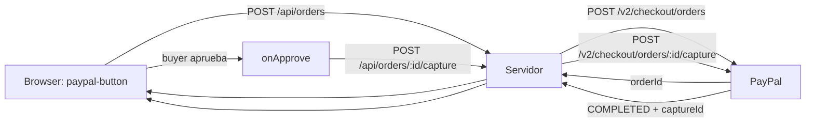

# Checkout

## Stack

- **Orders v2** en servidor para crear y capturar.
- **JavaScript SDK v6** en cliente para el botón y la sesión de pago.

## Flujo



## Orders v2

```http
POST /v2/checkout/orders
{
  "intent": "CAPTURE",
  "purchase_units": [{
    "amount": { "currency_code": "USD", "value": "10.00" }
  }]
}
```

| Operación | Endpoint |
|---|---|
| Crear orden | `POST /v2/checkout/orders` |
| Capturar | `POST /v2/checkout/orders/{orderId}/capture` |
| Autorizar | `intent: "AUTHORIZE"` + `POST /v2/payments/authorizations/{id}/capture` |
| Void | `POST /v2/payments/authorizations/{id}/void` |
| Reauthorize | `POST /v2/payments/authorizations/{id}/reauthorize` |
| Refund | `POST /v2/payments/captures/{captureId}/refund` |

- `intent: CAPTURE` cobra en un paso.
- `intent: AUTHORIZE` retiene hasta **29 días**; mejor tasa en los primeros **3 días**.
- Refund total o parcial; guarda el `captureId`.
- Void antes de capturar evita comisiones.

## JavaScript SDK v6

```html
<script async src="https://www.sandbox.paypal.com/web-sdk/v6/core" onload="onLoad()"></script>
```

```js
const sdk = await window.paypal.createInstance({
  clientId: "YOUR_CLIENT_ID",
  components: ["paypal-payments"],
});

const methods = await sdk.findEligibleMethods({ currencyCode: "USD" });
if (methods.isEligible("paypal")) {
  const btn = document.createElement("paypal-button");
  container.append(btn);

  const session = await sdk.createPayPalOneTimePaymentSession({
    onApprove: async ({ orderId }) => {
      await fetch(`/api/orders/${orderId}/capture`, { method: "POST" });
    },
    onCancel: () => {},
    onError: (e) => console.error(e),
  });

  btn.addEventListener("click", () =>
    session.start({ presentationMode: "auto" }, createOrder())
  );
}
```

- `findEligibleMethods` soporta: `paypal`, `venmo`, `paylater`, `credit`, `card`, `advanced_cards`, `applepay`, `googlepay`.
- `createOrder()` debe devolver una **promesa**; no la esperes antes de `session.start()`.
- Producción: `https://www.paypal.com/web-sdk/v6/core`.

## Reglas

- Crear la orden **siempre en servidor**; nunca confiar en el monto del cliente.
- Guardar `orderId`, `captureId` y estado.
- No mezclar SDK v5 y v6: checkout usa v6; subscriptions sigue en v5.
- La doc oficial tiene una inconsistencia: la tabla de `createInstance` marca `clientToken` como obligatorio, pero los ejemplos usan `clientId`. Para checkout normal usa `clientId`; `clientToken` es para Fastlane.

## Enlaces

- [[20 Autenticacion y sandbox]]
- [[22 Subscriptions e Invoicing]]
- Docs: https://developer.paypal.com/checkout
- Quickstart: https://developer.paypal.com/checkout/integrate/
- SDK v6: https://developer.paypal.com/sdk/js/reference
