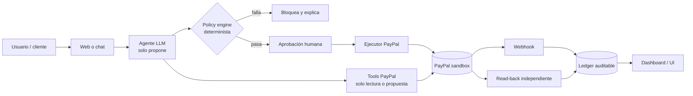

# Arquitectura canónica

## Diagrama

## Componentes

| Componente | Responsabilidad | Regla |
|---|---|---|
| UI | Intención, estado, evidencia | Nunca calcula montos finales |
| Agente | Propuesta tipada, explicación | Sin credenciales, sin escritura directa |
| Tools | Consultas y preparación | Mínimo privilegio |
| Policy engine | Límites, allow-list, dedupe | Código, no prompt |
| Aprobación | Consentimiento humano | Explícita e irreversible |
| Ejecutor | Llamada PayPal | Idempotente |
| Verificador | Relee el ledger | No confía en el retorno de la tool |
| Webhooks | Eventos externos | 2xx, firma, dedupe |
| Reconciliador | Recupera eventos perdidos | Cron |
| Ledger | Estado y auditoría | Append-only |
| Dashboard | Visualización | Datos reales, no mock |

## No negociables

1. La orden se crea en servidor.
2. El monto sale de una fuente de verdad, no del cliente.
3. El agente no tiene `client_secret`.
4. Toda acción de dinero pasa por policy + aprobación.
5. Toda acción se verifica contra PayPal.
6. Los webhooks se deduplican y se reconcilian.
7. El modo mock está etiquetado como mock.
8. El ledger permite reconstruir qué pasó.

## Stack posible

### Opción 1 · Next.js full-stack

- Next.js App Router + TypeScript.
- Route handlers para PayPal y webhooks.
- Postgres (Neon) o SQLite.
- AG Studio / Bryntum en el cliente.
- Render o Vercel.

### Opción 2 · FastAPI + Next

- FastAPI + Pydantic + SQLAlchemy.
- Next solo UI.
- Mejor si el equipo es Python-first.
- Más trabajo de integración.

## Modos de fallo

| Fallo | Respuesta |
|---|---|
| PayPal timeout | Reconciliar antes de reintentar |
| PayPal 5xx tras capture | `PENDING_VERIFICATION`; read-back antes de reintentar |
| Webhook perdido | Cron que relee la orden |
| LLM caído | Fallback determinista |
| Tool devuelve “success” falso | Verificador independiente |
| Pago duplicado | Idempotency key + dedupe |
| Disputa abierta | Congelar acción y escalar |
| Sandbox sin datos | Seed + modo demo etiquetado |

## Enlaces

- [[51 Patrones de confianza]]
- [[70 Stack y estructura]]
- [[73 Esquema de datos]]
