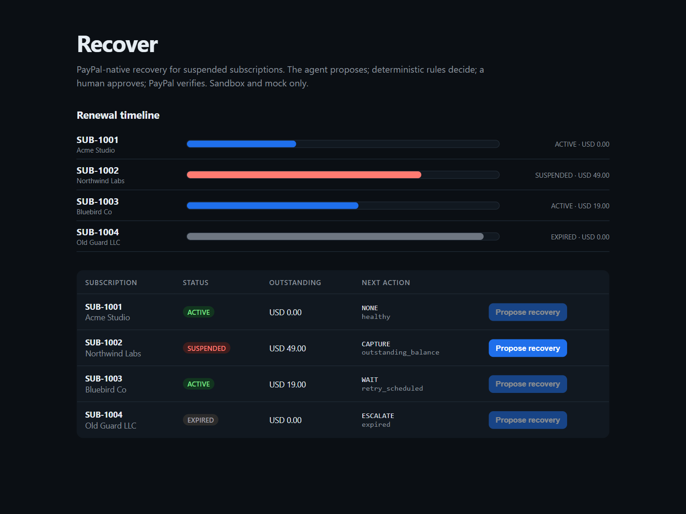

# Devpost submission draft — Recover

> Status: draft. Do not submit until the video, hosted demo and sandbox evidence are added.

## One-liner

**Recover** is a PayPal-native agent that turns a failed subscription renewal into a recovered outstanding balance before the subscriber churns.

## Problem

PayPal retries a failed subscription payment up to twice per billing cycle. If both attempts fail, the amount moves to the subscription's **outstanding balance**, and the subscription can be **suspended**. Small merchants often miss that state until the customer is gone.

## Solution

Recover reads the subscription, explains the failure reason, proposes one recovery action, and requires explicit human approval before capturing the outstanding balance. It then verifies the result and writes an append-only ledger.

## How it works

1. The timeline shows active, failed, suspended and expired subscriptions.
2. The merchant selects a suspended subscription with an outstanding balance.
3. The agent explains the PayPal `reason_code` and recommends an action.
4. The merchant approves the exact amount.
5. The server calls `POST /v1/billing/subscriptions/{id}/capture` with `capture_type: OUTSTANDING_BALANCE`.
6. If the subscription stays suspended, the server calls `/activate`.
7. The server reads the subscription back and records `proposal`, `capture` and `verify` events.

## PayPal integration

- Subscriptions API: `GET /v1/billing/subscriptions/{id}`, `capture`, `activate`.
- Webhooks: `POST /api/webhooks/paypal`, signature verification via PayPal when `PAYPAL_WEBHOOK_ID` is set, dedupe by `event.id`.
- OAuth 2.0 client credentials with token caching.
- Host allow-list: sandbox only.

## AI

- Deterministic reason-code explainer for the eight PayPal failure codes, plus `UNKNOWN`.
- Optional OpenAI-compatible LLM for wording only; it never decides amounts or executes payments.
- Fallback to deterministic output on timeout, invalid JSON or an invalid action.

## What is real vs mock

**Real:**

- Next.js app, API routes, approval gate, ledger, state machine.
- PayPal sandbox client code (OAuth, capture, activate, webhook verification).
- Webhook dedupe and malformed-input handling.

**Mock:**

- Capture without `PAYPAL_CLIENT_ID`/`SECRET`.
- Four seeded subscriptions.
- In-memory proposal and ledger stores.

**Not yet executed:**

- Real sandbox `OUTSTANDING_BALANCE` capture.
- Hosted demo.
- Video.

## Tools

- Next.js 15, React 19, TypeScript, Node.js.
- PayPal REST APIs (sandbox).
- Optional OpenAI-compatible LLM.
- Render blueprint (not deployed).
- Bryntum planned, **not included**; the timeline is CSS.

## Links

- Repo: https://github.com/LuisRz1/paypal-ai-hackathon-2026
- Local demo: [`web/DEMO.md`](web/DEMO.md)
- Video: pending
- Hosted demo: pending

## Compliance

- MIT license.
- `THIRD_PARTY_NOTICES.md` lists dependencies and external services.
- Sandbox/mock only; no real money.
- No credentials in the repository.

## Devpost fields

| Field | Draft |
|---|---|
| Title | Recover |
| Tagline | PayPal-native recovery for suspended subscriptions |
| Built with | Next.js, React, TypeScript, PayPal Subscriptions API, PayPal Webhooks, optional OpenAI-compatible LLM |
| Try it | Local instructions in `web/DEMO.md` (hosted URL pending) |
| Video | Pending |
| GitHub | https://github.com/LuisRz1/paypal-ai-hackathon-2026 |
